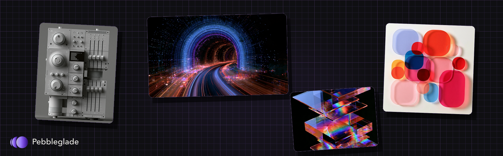

  &nbsp;
  &nbsp;
  &nbsp;
  

<strong>让 Agent 看见你的审美。</strong>

给设计师和 Agent 共用的情绪板。 
把参考、组名和判断，整理成一份 Agent 能读懂的风格摘要。

## 为什么做这个

Agent 很会生成。但它不知道你为什么选这张图。

你给它的是一句 prompt。它看不到你删掉的那 20 张，也不知道“高级”对你意味着什么。参考散在文件夹、截图和聊天记录里，每次合作都要重新解释。

Pebbleglade 把这些判断留在同一张情绪板上。Agent 拿到的不只是图片，还有你为什么留下它们。

## 一块板，两个读者

你看到的是参考、分组和项目。Agent 看到的是一份可读的风格摘要：关键词、色彩、构图、质感，以及适合的方向。

这样它生成的界面和画面，才有可能从你的选择开始，而不是从模型平均值开始。

## 怎么用

1. **收进同一张板。** 把界面、色彩、材质和氛围参考放在一起，按项目分开。
2. **给风格一个名字。** 给每组参考命名。名字就是你的判断。
3. **把摘要交给 Agent。** 参考和命名会整理成可读的风格摘要，让 Agent 从你的选择开始。

## 给谁

| 界面 | 画面 |
| --- | --- |
| **UI、交互与图形界面设计师** 把色彩、密度、状态和动效参考放在同一张板上。Agent 生成的界面，不再像模型平均值。 | **AIGC 与视觉创作者** 把氛围、光线、材质和构图交给 Agent。描述从形容词，变成你选过的画面。 |

## 现在

> **macOS 预览版已可下载：0.1.0-preview.3。**  
> [下载 Apple Silicon（M 系列）DMG](https://github.com/Lechoung-J/Pebbleglade/releases/download/v0.1.0-preview.3/Pebbleglade-0.1.0-preview.3-arm64.dmg) · [发行说明与安装方式](https://github.com/Lechoung-J/Pebbleglade/releases/tag/v0.1.0-preview.3)  
> 当前为本地签名预览，尚未完成 Apple 公证。Intel Mac、Windows 与 Linux 版本暂未发布。

## 资料

- [快速上手](docs/GETTING_STARTED.md)
- [常见问题](docs/FAQ.md)
- [媒体与品牌资料](docs/PRESS_KIT.md)
- [使用条款](LICENSE.txt)
- [隐私说明](PRIVACY.md)
- [第三方许可](THIRD_PARTY_NOTICES.md)
