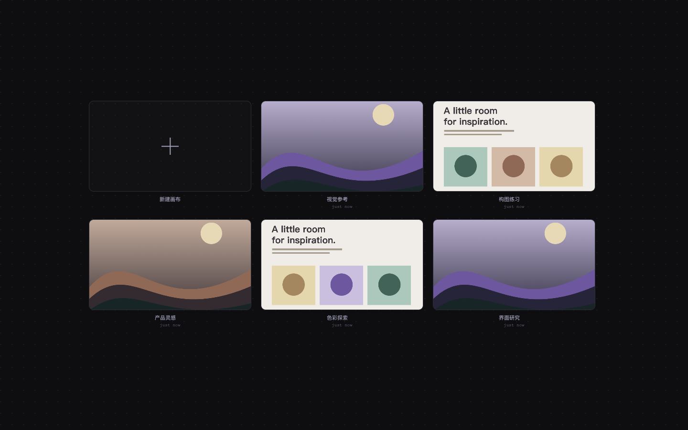

# 快速上手

打开 Pebbleglade，新建一块情绪板。
先放参考，再给风格一个名字，最后把判断交给 Agent。

## 1. 新建或继续

起始页左上角的加号用于新建情绪板。
其余缩略图代表最近打开的项目。
列表最多记住 50 块板，可以来自不同文件夹。

## 2. 收进同一张板

把界面、色彩、材质和氛围参考放进同一张画布。
按项目分开，不用再翻聊天记录。
选中单张图片时，可以在下方看到名称和尺寸。

## 3. 给风格一个名字

框选一组参考后，用右键菜单分组。
给每组命名，例如“冷静的界面”或“轻未来的光”。
组名就是你的判断，也会成为 Agent 理解这组参考的线索。

## 4. 按项目收好

一块情绪板对应一个项目。
项目多时，起始页的最近列表会自动更新。
双击项目名可以修改名称和本地文件名。
按 Enter 提交，按 Esc 取消。

## 5. 交给 Agent

打开「连接 Agent」，选择你使用的 Harness。
复制应用生成的连接指令，贴到对应的 Agent 聊天窗口并发送。
App 检测到真实 MCP 连接后，会显示打勾。

接好后，可以说：“读取鹅卵石当前画布，告诉我有哪些参考组。”
Agent 可以读取分组、拼板和备注，也能根据你的要求整理画布。

右键图片或完整分组可以添加备注，正文会常驻画布。
取消选中后，在空白处右键可添加独立文本框。
文本框写完后，可右键关联为图片或分组备注。

## 6. 复制与粘贴

选中图片，按 ⌘C 或右键「复制图片」写入系统剪贴板。
可粘贴到其他支持图片的输入框或应用。
复制只读取图片，不会在画布新增副本。

回到画布按 ⌘V，或在空白处右键「粘贴图片」才会新增。
需要立即在画布创建副本时，使用 ⌘D。
文字输入框保持原来的文字复制粘贴。

## 7. 保存

macOS 使用 ⌘S 保存，其他系统使用 Ctrl+S。
新画布使用 `.pebb` 文件。
旧 `.kanvaz` 可打开并另存为 `.pebb`，原文件会保留。
请为重要画布保留自己的备份。
